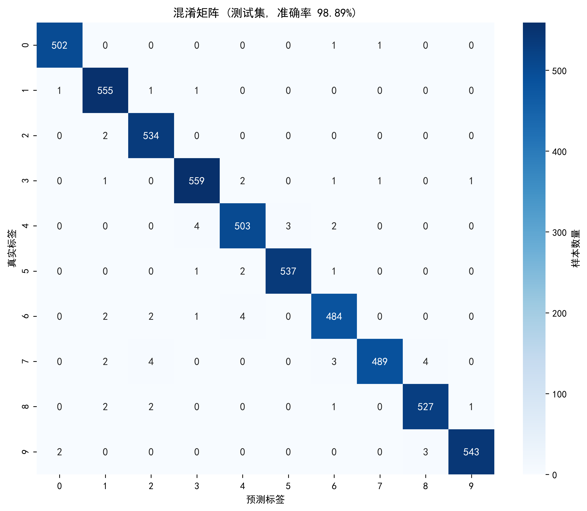
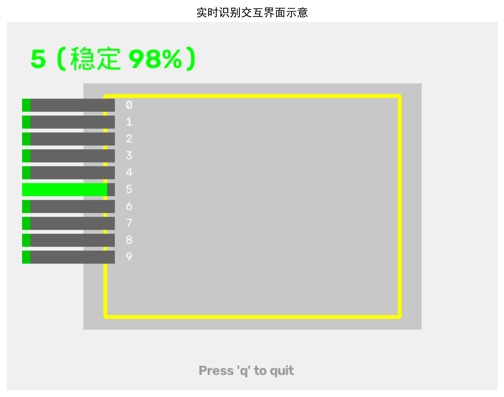

# 0-9 Gesture Digit Recognition with CNN

本项目为基于 **TensorFlow/Keras** 构建的卷积神经网络（CNN）课程设计，实现了 0-9 手势数字的端到端图像分类与摄像头实时识别。

## 📌 核心功能
- **数据预处理**：OpenCV 灰度化、64×64 尺寸归一化、像素归一化与数据增强。
- **轻量级 CNN**：三层卷积-池化结构 (32→64→128)，搭配 Dropout 防止过拟合。
- **实时防抖推理**：集成摄像头视频流，通过 10 帧滑动窗口投票机制抑制预测抖动。
- **性能评估**：生成混淆矩阵、ROC/AUC 曲线，量化分析模型性能。

## 🛠 技术栈
- **深度学习框架**: TensorFlow 2.x, Keras
- **计算机视觉**: OpenCV
- **数据分析**: NumPy, Scikit-learn, Matplotlib
- **语言**: Python 3.8

## 📊 实验结果
- **测试集准确率**: 98.89%
- **Macro F1-score**: 98.89%
- **推理性能**: CPU 单帧 20~30ms，稳定输出 20~25 FPS

### 混淆矩阵


### 实时识别效果


## 📂 文件结构
- `train_cnn.py`: 模型定义与训练脚本
- `evaluate_cnn.py`: 模型评估与指标可视化
- `real.py`: 摄像头实时推理与防抖脚本
- `collect_data.py`: 手势图像采集脚本
- `config.py`: 全局参数配置

## 🚀 运行指南
1. 安装依赖：
   ```bash
   pip install tensorflow opencv-python numpy scikit-learn matplotlib
